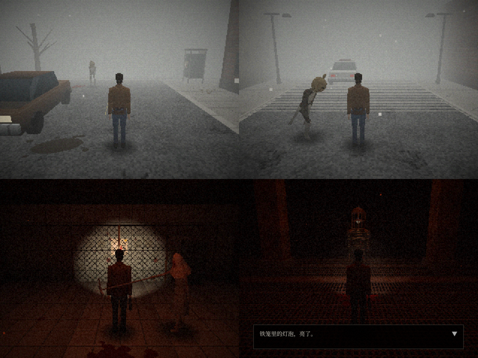

# MISTWATER

**A retro 32-bit-era survival horror demo that runs directly in the browser.**
一款向 32 位主机时代致敬的复古生存恐怖游戏 Demo，浏览器直接游玩。

▶ **Play / 在线试玩：** https://bao5ye.github.io/mistwater/



## Story / 剧情
A father wakes up after a car crash on the outskirts of a fog-bound town. His daughter is gone.
In the drifting ash he finds a crayon drawing pointing to the town hospital — and when the siren sounds, the world rusts.

车祸醒来，女儿小雨不见了。在灰烬飘落的雾中小镇里，一张蜡笔画指向镇北的医院；警报声响起时，世界开始锈蚀。

Three chapters · about 15 minutes · difficulty NORMAL
三个章节：FOG（雾中小镇）→ RUST（里世界医院）→ EXECUTION（处刑室 Boss 战）

## Features / 特点
- **Single file, zero dependencies** — one `index.html` (~1.5 MB). Custom WebGL renderer, no engine, no CDN.
- **PS1-style pipeline** — 320×240 render target, vertex snapping, 15-bit color with ordered dithering, film grain, scanlines.
- **Lighting** — per-pixel lighting, real-time flashlight shadow map with volumetric beam, flickering lights, contact shadows.
- **Blender-built characters** — protagonist and three original monsters generated by Python scripts in `blender/`, exported as glTF and embedded.
- **Procedural everything else** — texture atlas (English signage), props, and a fully synthesized Web Audio score (strings, piano, tremolo plucks, choir, industrial ambience).
- **Tank controls** like the classics; touch controls on mobile.

## Controls / 操作
| Keyboard | Action |
|---|---|
| ↑ ↓ | Forward / back 前进后退 |
| ← → | Turn 转身 |
| Shift | Run 奔跑 |
| Z (hold) | Aim & lock on 瞄准锁定 |
| X / Space | Attack 攻击 |
| E / Enter | Check / confirm 调查 |
| F | Flashlight 手电 |
| Q | Swap weapon 换武器 |
| H | Heal 回复 |
| Tab | Menu 菜单 |

Touch devices show on-screen buttons. 手机端显示虚拟按键，建议横屏。

## Repository layout / 目录
```
index.html          the built game (play this) 可直接游玩的成品
src/src.html        game source without embedded assets 源码模板
src/build.py        embeds assets/ into index.html 构建脚本
src/glb2js.py       converts Blender .glb to embedded JSON glTF 转换
assets/             converted models + texture atlases 模型与贴图
blender/            Blender scripts that generate the characters 角色建模脚本
docs/               screenshots 截图
```

## Rebuilding the characters / 重新生成角色
Requires Blender 4.x / 5.x.
```
blender -b -P blender/mistwater_hero.py       # protagonist
blender -b -P blender/mistwater_monsters.py   # bag man, hooded patient, cage executioner
python src/glb2js.py blender/mistwater_hero.glb assets/hero.json   # (and bag / nurse / boss)
python src/build.py
```

## Credits
Design & direction: **Bao5ye** · Built in human–AI collaboration with Claude (Anthropic).
All characters, locations, music and art in this project are original. It is an homage to the atmosphere of 1990s survival horror and is not affiliated with any commercial franchise.

本项目所有角色、场景、音乐与美术均为原创，仅向 90 年代生存恐怖游戏的氛围致敬，与任何商业作品无关。

Licensed under the [MIT License](LICENSE).
